<!-- Banner Header (Ganti nama & teks setelah tanda '=' sesuai keinginan, gunakan '+' untuk spasi) -->
.png)
# Hi there! 👋 welcone in my GitHub

### 💻 Full-stack Web Developer | 🎨 Visual & Interface Builder | ⚡ Always Exploring Tech

> *"Small consistent steps in code and design build things that last."*  Turning ideas into real, usable projects.

I'm an software engineering student who enjoys crafting clean web interfaces, experimenting with programming logic, and building practical tools from scratch. My focus lies in combining structured code, clear visual hierarchy, and steady problem-solving to create projects that are both useful and pleasant to use.

<!-- Animasi GIF Coding -->
<!-- Animasi GIF Terminal Glitch -->

### 🛠️ The Stack

### 🎮 Games 

### 📱Connect

### My GitHub Stats

### Play Games With Me
<picture data-importer="pacman">
  <source media="(prefers-color-scheme: dark)" srcset="https://raw.githubusercontent.com/anggrapratama/anggrapratama/pacman-output/pacman-contribution-graph-dark.svg?game=pacman">
  <source media="(prefers-color-scheme: light)" srcset="https://raw.githubusercontent.com/anggrapratama/anggrapratama/pacman-output/pacman-contribution-graph.svg?game=pacman">
  
</picture>

###

###